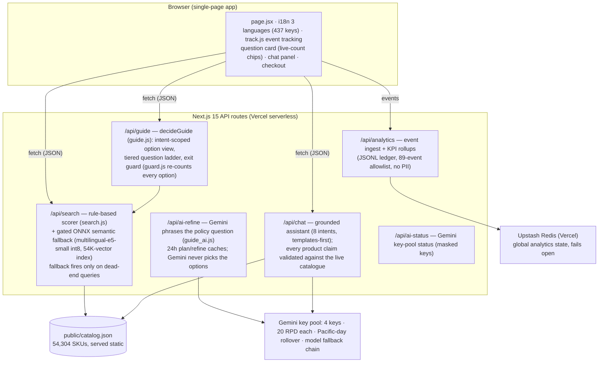

# AskCart — Guided E-Commerce Search MVP

When a search returns nothing, most shops show a dead end. AskCart instead asks **one short follow-up question** (budget / occasion / category), re-searches with the captured intent, and adds a grounded AI shopping assistant. Next.js 15 on Vercel, Gemini at the edges, DuckDB-built data pipeline underneath.

## Live

- **MVP (Vercel, production):** https://askcart-nine.vercel.app — search, guided follow-up, AI chat, analytics dashboard
- **Agentic review extractor (Hugging Face Space, runs in your browser):** https://pm-ai-18-askcart-extractor.static.hf.space/ — the 6-source corpus pipeline, browser-computed

## Results (measured, reproducible — evidence in `docs/evidence/`)

- Guided budget/occasion follow-up: **null results 27.3% → 8.0%**; 78.7% of journeys resolved within 2 turns (n=150).
- 3,000-query simulation: **100% resolved, 0.0% null, 98.6% by turn 2, 0 errors** (`eval/simulate.py`).
- **54,304-SKU catalogue**: 24,998 real Amazon products (USD→INR, band-stratified) + 11,047 India listing-matrix SKUs (real brands, 2026 INR MRPs, every occasion and price stratum) + 237 curated Indian models.
- Agentic extractor over **6 sources** (Play/App Store app reviews, Reddit, Amazon product reviews, Trustpilot, Google Suggest / Wikipedia pageviews): **~95K reviews → 4 root causes** via a 6-stage SQL pipeline + Bayesian ratings (`data/pipeline_counts.json`).
- Grounded in **12 online-shopper interviews** ("shaadi gift under 2k" cohort) and a search-to-cart journey map; 3 of 5 drop-off points were prioritized and solved.

## System design



**Key decisions**

- **Deterministic core, LLM at the edges.** The rule-based policy decides which question to ask and what the options are; Gemini only phrases it and grounds chat answers. The rule path makes **zero LLM calls** — the whole app runs with no key at all.
- **Search (v6).** Word-level prefix matching over a cached word index with natural-language parsing for budgets, occasions, categories, brands, Hinglish and INR spec units (7kg, 1.5 ton, 1100va); spec numbers are never confused with budgets; budget-only queries get browse mode instead of a null page. Algorithm: `docs/followup_algorithm.md`, regression canaries: `eval/canaries.py` (44 queries).
- **Guardrails.** Every follow-up option is re-counted against the visible candidate set before display; chat answers only from catalogue fields ("I don't have that detail" otherwise); 89-event allowlist with a CI check that fails on unregistered events; no PII.
- **Assistant.** Deterministic dialog manager, templates-first, LLM off by default (`CHAT_LLM=0`); signed conversation state (HMAC), 30-turn cap, rate limit. Spec + gates: `docs/chat_spec.md`.
- **Persistence.** Local JSONL/state files; on Vercel, `ASKCARD_REDIS_URL` (Upstash) makes the analytics dashboard global across instances and fails open without it.

## How to run

**App** (Vercel-ready, Next 15):

```bash
cd app
npm install
npm run dev        # http://localhost:3000
```

Env vars (all optional — without keys the app falls back to deterministic rule-based follow-ups): `GEMINI_API_KEYS` pool (or legacy `GEMINI_API_KEY`), `GEMINI_MODEL`, `GEMINI_RPD`, `AI_MAX_PER_SESSION`, `ASKCARD_REDIS_URL`, `SEMANTIC_FALLBACK=0` to reproduce the committed study numbers exactly.

**Data + study reproduction** (one-shot, LLM-optional):

```bash
scripts/run_all.sh             # corpus → SQL pipeline → LLM labels → catalogue → semantic index
.venv/bin/python eval/simulate.py   # 3,000-query resolution study
.venv/bin/python eval/canaries.py   # search regression canaries
```

## Repository layout

```
app/               Next.js 15 app (app/ = server logic, app/app/ = client; public/catalog.json)
extractor/         6-source agentic collectors + LLM labeller (also built as the HF Space, space_askcart/)
pipeline/          6-stage DuckDB SQL pipeline + Bayesian ratings
scripts/           catalogue builders (Amazon INR, India layer, supplement), run_all.sh, deploy tooling
eval/              simulate.py, canaries.py, chat gates, relevance audit
docs/              PRD, UI spec, follow-up algorithm, chat spec, event schema, evidence/ (claim provenance, source notes, figures)
data/              pipeline counts + study corpora
```

## Docs & evidence

- [Full PRD](docs/ASKCART_PRD.md) · [Follow-up algorithm](docs/followup_algorithm.md) · [Chat spec](docs/chat_spec.md)
- [Claim provenance (every number, how it was measured)](docs/evidence/claim_provenance.md) · [Deploy notes](docs/evidence/deploy.md)
