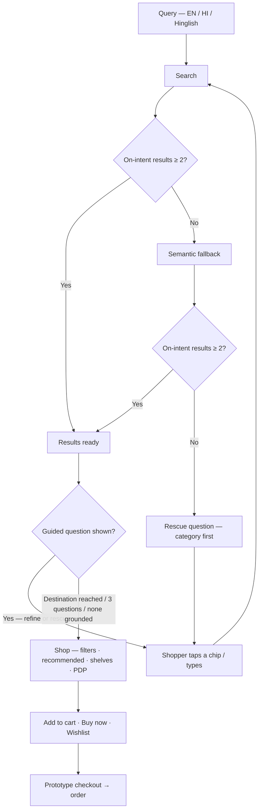
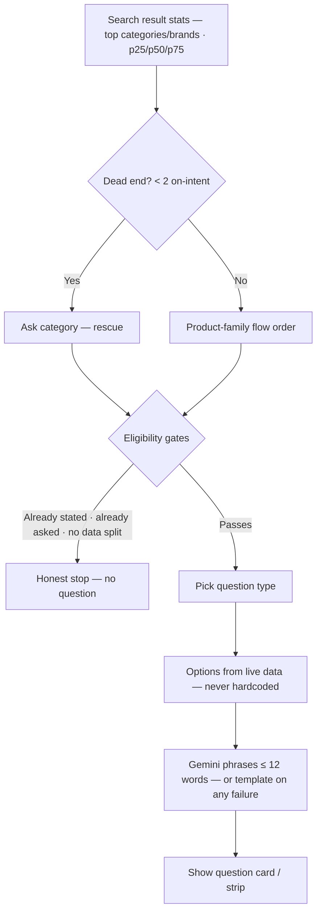
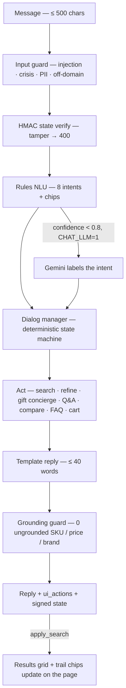
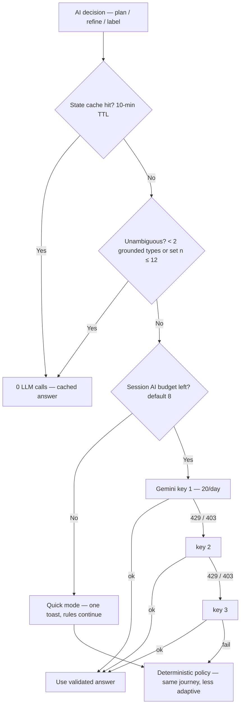

# AskCart V1 PRD

## 1. Basics

| Field | Details |
| --- | --- |
| Feature | AskCart — Guided E-Commerce Search (India) |
| Owner | Suparna Deshmukh |
| Status | In review |
| Date | 11/09/2026 |
| Design document link | `docs/ASKCART_UI_SPEC.md` (repo) — token-level UI specification, verified against shipped code |
| Preview link (Prototype) | http://localhost:3000 (local dev) · Vercel (Bits account, `app/`) · Extractor dashboard: https://pm-ai-18-askcart-extractor.static.hf.space/ |
| Reference PRD | QC Interface V0 PRD (format reference) |

## 2. Summary

AskCart is a guided e-commerce search MVP for Indian shoppers. Shoppers search in plain English, Hindi or Hinglish — "shaadi gift under 2k", "1.5 ton ac under 45k", "saree for ammi". When the engine cannot resolve the query on the first pass, AskCart asks ONE short follow-up question (budget, occasion, category, brand, for-whom, size or capacity) with 3–4 one-tap options, re-searches with the captured intent, and keeps asking — up to 3 questions / 4 turns — until the shopper is at the product.

The product runs on a 54,304-SKU demo catalogue (real brands, real INR MRPs, every occasion and economic stratum) with a deterministic search and question policy. Gemini only phrases questions and labels low-confidence chat input — it never chooses products, prices, brands or questions. Every AI path has a deterministic fallback, so the whole product runs with zero LLM availability. An AI shopping assistant, persona-calibrated recommendations, mid-search filters, prototype checkout and a live product-analytics dashboard complete the loop. Measured: failed searches 27.3% → 8.0% (n=150 study), 78.7% of journeys resolved within 2 turns; 3,000-query simulation: 0.0% null, 100% resolved, 0 errors.

## 3. The problem

Indian online shoppers search the way they'd ask a person: budget-bearing, occasion-bearing, recipient-bearing, conversational. Legacy keyword search is not built for that. We did not guess the failure modes — we mined them.

An agentic extractor collected **94,643 real reviews** from 5 sources (Play Store, App Store, Reddit, Amazon product reviews, Trustpilot) plus demand/seasonality signals (Google Suggest IN, Wikipedia pageviews). A 6-stage DuckDB pipeline cleaned them to 87,603, gated 6,041 search-UX complaints, and every complaint was LLM-labelled under a 6-class taxonomy.

| Root cause | Share of complaints | What it means for the shopper |
| --- | --- | --- |
| trust_gap | 54.4% | "Is this brand/store legit?" — generic listings outrank genuine ones |
| budget_mismatch | 9.4% | Query carried a budget ("under 2k") but results ignored it |
| zero_or_wrong | 3.5% | Empty results or wrong category — a dead end with no recovery path |
| occasion_blindness | 0.7% | "gift", "shaadi", "diwali" ARE the product spec; engines treat them as noise |
| not_search_related | 30.2% | Reported honestly, not forced into a search cause (no question) |
| other | 1.8% | Shopping-relevant, no other class (no question) |

Twelve corpus-grounded shopper personas (P1–P12) were mapped on a search-to-cart journey. Five drop-off points were found; this product directly solves three:

| Drop-off | Where | Solved by this MVP? |
| --- | --- | --- |
| D1 — budget not captured | results ignore "under X" | Yes — guided budget question + budget-aware re-search |
| D2 — occasion ignored | gift queries ranked as literal | Yes — occasion question + occasion-tag matching |
| D3 — zero-result dead end | empty page, shopper leaves | Yes — rescue question loop with nearest-category offers |
| D4 — trust | unbranded/generic cards | Partial — brand question, ratings; full trust layer is phase 2 |
| D5 — ranking quality | keyword-stuffed listings rank high | Partial — intent scoring, brand bonuses; ML re-rank is phase 2 |

<b>The product thesis:</b> if an engine cannot resolve a conversational query on the first pass, the cheapest and highest-converting recovery is <b>one short, well-timed follow-up question</b> — not a wall of filters, not a chatbot monologue. AskCart measures exactly that.

## 4. Goals and non-goals

<b>Goals</b>

- Resolve conversational, budget-bearing, occasion-bearing Indian search with at most one short question at a time.
- Convert every zero-result dead end into a working answer (category rescue) — never a bare "no results".
- Capture and measure every step of the search-to-cart journey on a shared live dashboard, with the study evidence visible in-product.
- Keep the product 100% functional with zero LLM availability (deterministic fallback on every AI path).
- Back every claim with reproducible artifacts (n=150 study, 3,000-query simulation, 44-query canaries, held-out panels).

<b>Outside V1</b>

- Real payments, address capture and fulfilment (prototype checkout only).
- Product imagery (deliberate text-only cards; shelf is image-ready).
- ML re-rank and A/B-tested personalisation (deterministic `recommendScore` only).
- Trust layer on cards — review snippets, ranking transparency (drop-offs D4/D5).
- Hinglish/Hindi output phrasing (inputs are fully understood; outputs are English templates, optionally phrased by Gemini).
- Cross-session personalisation (persona is per-browser; no accounts).
- Historical analytics (in-memory store resets on server restart, by design).
- Live supplier/affiliate SKU feed (curated demo catalogue).

## 5. Users and access

- <b>Shopper</b> (no account) — the primary user. Lands on the Search tab. First-visit shoppers answer a 3-question persona (or skip).
- <b>Returning shopper</b> — persona, cart, orders and wishlist persist per browser (localStorage). No sign-in, no sync.
- <b>Evaluator / reviewer</b> — reads the Validation & Study tab; every number is read live from eval artifacts, nothing is preset.
- <b>Admin</b> — the Backend (Admin) analytics sub-tab: AI routing, key ledger, engine mix.

Rules:

- No authentication and no accounts in V1: every visitor has full access to search, cart, orders and analytics. Access control is not a V1 requirement.
- <b>Guided is the only mode.</b> There is no mode picker for shoppers; the question loop is always on.
- <b>Language</b>: English / हिंदी / Hinglish, switchable at any time from the top bar; persisted per browser; sets `<html lang>` (en / hi / hi-Latn).
- <b>Pincode</b>: optional 6 digits, never leaves the browser. Only the coarse 2-digit-prefix region (north / east / west / south / ne / central) is used, for regional festival ordering and the demo delivery estimate.
- <b>Null definition.</b> A search is <b>null (failed)</b> when it returns <b>fewer than 2 on-intent results</b>. This single definition is used everywhere — live dashboard, study, simulation — so the numbers are comparable.
- <b>Journey.</b> A journey is a search plus its follow-up turns, until resolution, exhaustion, order, or a new search. `journey_end` owns the turn buckets (t1…t4 / unresolved) so turns are never double-counted.

## 6. Workflow

### 6.1 Shopper journey (user journey)



Loop contract (the guided contract, as shipped):

1. Every search gets a question surface on top of the results — a rescue card ("One quick question") for dead ends, an optional strip ("Optional refinement — the results below are ready to shop") for resolved searches — including spec queries, Hinglish and typos.
2. Every question carries 3–4 live-counted, mutually exclusive, recipient-aware options ("gift for 5 year old" → kids-only options) plus a typed "Something else…" row.
3. No re-asking what the query already said (budget, recipient, size, brand slots are pre-filled).
4. Each answer narrows the set and triggers the next question on that narrowed set. The loop continues until exactly one product ("your pick" stop), the destination stop (below), questions are exhausted, or 3 skips.
5. Skip keeps the loop going (the server picks the next question).
6. Trail chips (query → each answered option) are removable at any time; removing one re-runs the search without that constraint.
7. Silent caps are banned: any applied default (e.g. "Not sure / flexible" → persona budget) shows as a removable trail chip.

### 6.2 Question policy (what is asked, in what order)



<b>Question types</b> — 7, each grounded in a mined root cause or a measured drop-off:

| Type | Grounding | Options (always data-driven) |
| --- | --- | --- |
| budget | budget_mismatch (9.4%); collapses the candidate set where it is widest | p25 / p25–p50 / p50–p75 of the live candidate set, rounded to clean INR steps + "Not sure / flexible" |
| occasion | occasion_blindness (0.7%); for gift intent the occasion IS the product | Fixed vocabulary: Gift / Birthday / Wedding–Shaadi / Anniversary / Diwali–Festival / Everyday use (1:1 to catalogue tags) |
| category | zero_or_wrong (3.5%); the rescue | Top-4 categories of the candidate set (live count per chip; zero-count disabled) |
| brand | trust_gap (54.4%); never the first question — it refines, it doesn't rescue | Top-3 brands in the set + "No preference — best rated" |
| for_whom | fashion is the largest catalogue family; the strongest single filter there | Women / Men / Kids, recipient-aware |
| size | spec-fit from listing-matrix variants | S/M/L/XL spread in the set |
| capacity | spec-fit for appliances | Tonnage / kg / litres in the set |

<b>Per-product-family flows</b> (first → last):

| Product family | Flow | Why |
| --- | --- | --- |
| Phones / Electronics / Computers / Appliances / Camera | budget → brand | price variance spans an order of magnitude; brand is the trust proxy |
| Fashion / Beauty / Toys / Baby / Handmade / Arts | occasion → budget → (brand) | the occasion is the product (a shaadi dress ≠ a party dress) |
| Home / Tools | budget → occasion | functional purchase; occasion only matters when gifting |
| Sports / Office / Pets / Automotive | budget → category | use-case ambiguity |
| Gift query, no parsed recipient | for_whom → occasion → budget → brand | the recipient decides what "a gift" means before the occasion does |

Every flow is followed by a <b>universal tail</b> (for_whom → brand → size → capacity, de-duplicated) so a resolved search almost always has a next, data-supported question instead of dead-ending.

<b>Eligibility (minimum-question principle)</b> — a question is asked only when it is unknown, the candidate set actually splits on it, and answering it would remove a meaningful slice:

- No type is ever repeated; brand is never the first question.
- Budget is skipped when the query already states a cap; occasion is skipped when a real occasion is parsed; category is skipped in refinement when one category dominates (>70%).
- A spec-slot query ("1.5 ton ac under 45k", "128gb phone under 20k") is a direct-buy call: occasion and for-whom are skipped.
- A relationship-hint query ("saree for ammi") already knows its recipient: for-whom is skipped.
- A-grade data floors: budget only when the on-intent range is genuinely wide (p75/p25 ≥ 4×) or high-ticket (p50 ≥ ₹15k), never wider than 15×; occasion only when ≥2 options each carry ≥max(5, 3% of the set) items and cover ≥15% of the set; brand only when the top brand ≥8%, top-3 ≥25%, and the counts actually separate; size only on fit garments with a real spread.

<b>Stop conditions</b>

- <b>Destination stop:</b> ≥2 of {budget, occasion, for_whom, size, capacity} settled (stated in the query or already answered) and ≥10 results on screen → no further question.
- <b>Hard cap:</b> 3 questions / 4 turns per journey; 3 skips ends the questioning.
- <b>Always-ask floor:</b> a search that has results still gets its first question unless the A-grade gates find nothing grounded; in that case a relaxed ladder (for_whom → occasion → subject-free category → budget → size → brand) applies floors that mirror measured judge verdicts. If no tier passes, the honest stop stands — no quiz on "soap" or "ipone 15".
- <b>Exhaustion honesty:</b> out-of-catalogue products ("samovar") get category rescue with the nearest shelf; when no question remains, an honest not-found with a rephrase hint and example-chip escape — never a fabricated product.

### 6.3 Search backend

```mermaid
%%{init: {"flowchart": {"useMaxWidth": false, "nodeSpacing": 55, "rankSpacing": 85}, "themeVariables": {"fontSize": "18px"}}}%%
flowchart TD
    U[POST /api/search — query] --> P[parseQuery — budget · spec units · occasion · recipient · brand · Hinglish stops]
    P --> L[Lexical — word-index prefix match · score · rank]
    L --> G{intent_n ≥ 2?}
    G -->|Yes| M[Merge + searchStats]
    G -->|No| SEM[Semantic fallback — e5-small int8 · top-200 cosine · hard constraints · τ 0.845 + margin 0.03]
    SEM --> G2{≥ 2 pass τ + constraints?}
    G2 -->|Yes| M
    G2 -->|No| M2[Merge — empty / near-miss]
    M2 --> M
    M --> PL{Guide plan for this journey}
    PL -->|Cache hit · unambiguous · session budget out| RULE[Deterministic policy — family flow + live options]
    PL -->|Else| GEM[Gemini — one plan call per journey, 10-min cache]
    GEM --> VAL[Validate — types in grounded set · phrasing ≤ 12 words · options untouched]
    VAL --> RULE
    RULE --> R[Response — ≤ 48 scored results + decision {type, options, question, reason}]
```

- <b>parseQuery</b> extracts budget ("under 2k", "1.5 lakh", "₹5000" — multiplier table for k/lakh/cr), occasion words (shaadi → wedding, rakhi → diwali, xmas → christmas), recipient words (ammi/didi/papa/beta → women/men/kids), brand words, and ~90 Hinglish stop-words. Spec units stuck to numbers (7kg, 1.5 ton, 1100va, 23l, 500w, 43 inch) are normalised into product tokens <b>even when a budget word is present</b>, and budget-captured numbers are stripped from the token stream — "under 3000" never matches "Voltage Stabilizer 3000 VA", and "1 lakh" is 100,000, not ₹1.
- <b>Lexical engine:</b> cached word index over the catalogue; word-level bounded prefix matching (tokens ≥5 chars, at most 3 extra chars — "mat" never matches "maternity"); singular/plural agreement; synonym table (phone↔smartphone/iphone/nokia/itel/karbonn, watch↔smartwatch, tv↔television, blender↔mixer, computer↔laptop). Scoring: required-token hits, front-of-title bonus, occasion-tag intent match, budget cap (strict, or ×1.6 relaxed and <b>labelled</b>), brand exact +2, first-word brand +0.75, car/auto context −1.0, adult-recipient vs kids-title −1.5, gender mismatch −1.0, modifier bonus (capped 1.5), accessory-hint −1.5, rating tiebreak ×0.15.
- <b>Budget-only queries</b> ("under 500") get browse mode — top-rated within the cap, gift-tagged preferred — never a null page.
- <b>Feature phones:</b> "phone under 15k" returns smartphones; "nokia under 2k" returns feature phones (brand synonyms with a flat base).
- <b>Semantic fallback</b> (inside the same `/api/search` call, additive only): when the lexical engine returns <2 on-intent results, the query (budget/spec/stop-words stripped, occasion+recipient kept) is embedded with `Xenova/multilingual-e5-small` (384-dim int8 ONNX, local — the same model and tokenizer built the catalogue index). Top-200 by cosine (~20 ms) pass the hard constraints (budget strict → ×1.6 relaxed and labelled; exact brand; the same gender/kids/car/accessory penalties; ≤2 per title stem), then a threshold gate keeps `cos ≥ τ (0.845)` and `cos ≥ top1 − 0.03`, calibrated on the dev split only. <b>No-op guarantee:</b> every query the lexical engine resolves returns a byte-identical response (zero-tolerance test suite). <b>Integrity gate:</b> the index carries the catalogue's SKU-order sha256; any mismatch disables semantic (`index_mismatch`) — misaligned rows are never served. Kill switch `SEMANTIC_FALLBACK=0`.
- <b>searchStats</b> (top-4 categories, top-4 brands, p25/p50/p75 of the candidate set) powers all option generation.

### 6.4 Assistant conversation (chat)



- Chat and page share <b>one session</b>: a chat search pushes `apply_search` ui_actions that update the results grid and trail chips; chat reads page context (PDP sku, last query) so "the second one" and "yeh acche hain kya" resolve. Card and chat never double-ask (one `pendingQuestion`).
- Intents, gift flow, grounded Q&A and safety are specified in US 8.

### 6.5 LLM routing (Gemini 3-key chain)



- One <b>plan call</b> per journey owns the whole question ladder (up to 7 question types in ask-order, each with ≤12-word phrasing), cached 10 minutes on `query|slots|persona` — later turns in the same journey cost 0 calls. One <b>refine</b> call per chip answer (filters-only) with every proposed value re-validated against the live narrowed set.
- Ledger: a local per-key per-day count (Google exposes no per-key usage endpoint for plain keys). 429/403 marks the key `exhaustedDay` and rotates (toast + `ai_key_exhausted` event); 400 invalid key marks it invalid for the day; 404/5xx/timeout cools the <i>model</i> (5 min / 1 min), not the key, with a sticky known-good model.
- The top-bar AI pill shows the running `x/60 today` total across all keys and users, per-key counts on hover. The pill is informational — it is never interactive.

## 7. Requirements

Each story's criteria apply to its named screen. Shared rules are defined once: the question policy in section 6, controls in section 8, edge cases in section 9.

### US 1: Search in plain language

As a shopper, I want to search in English, Hindi or Hinglish — with budgets, specs, occasions and recipients in the same sentence — and get on-intent results.

| AC | Acceptance criterion |
| --- | --- |
| 1 | Search bar in the hero (placeholder cycling through the 18 example queries) and in the compact active-search state; Enter submits; the submit button shows "…" while busy and is disabled. 18 example chips (section 14) each start a search with `source: example`. Deep link `/?q=…` auto-runs the search exactly once (StrictMode-guarded). |
| 2 | `parseQuery` extracts budget ("under 2k", "1.5 lakh", "₹5000", "max 30000" — multiplier table for k/lakh/cr), occasion words (shaadi/shadi/शादी → wedding, rakhi → diwali, xmas → christmas), recipient words (ammi/didi/papa/beta… → women/men/kids), brand words, and ~90 Hinglish stop-words (ka/ki/ke, mujhe, kya, sasta…). |
| 3 | Spec units stuck to numbers (7kg, 1.5 ton, 1100va, 23l, 500w, 43 inch) normalise into product tokens even when a budget word is present; budget-captured numbers are stripped from the token stream. "7kg washing machine under 25k" matches 7 kg machines — never a ₹7 product; "1 lakh" = ₹100,000. |
| 4 | Matching: cached word index, word-level bounded prefix (≥5-char tokens, at most 3 extra chars — "mat" never matches "maternity"), singular/plural agreement, synonym table (phone↔smartphone/iphone/nokia/itel/karbonn, watch↔smartwatch, tv↔television, blender↔mixer, computer↔laptop). "Phone under 15k" returns smartphones; "nokia under 2k" returns feature phones. |
| 5 | Scoring: required-token hits, front-of-title position bonus, occasion-tag intent match, budget cap (strict; ×1.6 relaxed and labelled "Slightly over your budget" — never silent), brand exact +2, first-word brand +0.75 (genuine "Redmi 13C…" beats keyword-stuffed listings), car/auto context −1.0, adult-recipient vs kids-title −1.5, gender mismatch −1.0, modifier bonus (capped 1.5), accessory-hint −1.5 (a "phone" query does not surface cases first), rating tiebreak ×0.15. |
| 6 | Budget-only queries ("under 500") open browse mode — top-rated within the cap, gift-tagged preferred — never a null page. "Sasta smartwatch" applies a price-descending bias (sasta = cheap). |
| 7 | Semantic fallback runs only when the lexical engine returns <2 on-intent results: e5-small multilingual int8 (local ONNX), top-200 by cosine, hard constraints (budget strict → ×1.6 labelled, exact brand, gender/kids/car/accessory penalties, ≤2 per title stem), keep `cos ≥ 0.845` and `cos ≥ top1 − 0.03`. No-op guarantee: lexical-resolved queries return byte-identical responses (zero-tolerance suite). Index integrity: SKU-order sha256 mismatch → semantic skipped (`index_mismatch`). Kill switch `SEMANTIC_FALLBACK=0` restores the lexical-only behaviour exactly. |
| 8 | Response carries up to 48 scored results plus `searchStats` (top-4 categories/brands, p25/p50/p75) and the guide decision. `null = intent_n < 2` is computed identically client and server so UI, study and dashboard share one definition. |

### US 2: Guided follow-up questions

As a shopper whose search is ambiguous or empty, I want one short question with tappable options — not a wall of filters — and the results to improve with each answer.

| AC | Acceptance criterion |
| --- | --- |
| 1 | A question surface renders on top of the results for every search: a rescue card ("One quick question") for dead ends and an optional strip ("Optional refinement — the results below are ready to shop") for resolved searches. The results are always visible and shoppable beneath it. Guided is the only mode. |
| 2 | Seven question types (budget, occasion, category, brand, for_whom, size, capacity), each grounded in a mined root cause or a measured drop-off. No question is asked for style. |
| 3 | Family flows as in section 6.2 (electronics: budget→brand; fashion: occasion→budget; home: budget→occasion; gift: for_whom→occasion→budget→brand), followed by the universal tail. A spec-slot query skips occasion/for-whom; a relationship-hint query skips for-whom. |
| 4 | Eligibility: no type repeated; brand never at turn ≤ 1; budget skipped when the query has a cap; occasion skipped when a real occasion is parsed; category skipped in refinement when one category dominates (>70%); A-grade data floors as in section 6.2. A search with no grounded facet asks nothing — never a quiz. |
| 5 | Options are always computed from the live candidate set, never hardcoded: budget from p25/p50/p75 rounded to clean INR steps; occasion from the fixed vocabulary; category from the top-4 in the set; brand from the top-3 + "No preference — best rated". 3–4 options per question, each with its live item count; zero-count options are disabled. Recipient-aware ("gift for 5 year old" → kids-only options). |
| 6 | Answering: chip tap (radiogroup; time-to-first-click tracked) or typed row. Typed brand answers must name a catalogue brand, otherwise the message is re-read as a normal message; a bare number is always a budget answer. Each answer re-searches with the constraint (relaxation labelled) and shows the next question on the narrowed set. |
| 7 | Stops: destination stop (≥2 facets settled + ≥10 results on screen); hard cap 3 questions / 4 turns; 3 skips ends the questioning; skip alone keeps the loop going with the next eligible type. |
| 8 | Trail breadcrumb under the search bar shows `query → answer → answer`; every chip is removable and removing it re-runs the search without that constraint. Applied defaults (persona budget on "Not sure / flexible") appear as removable chips — silent defaults are banned. |
| 9 | Rollback guard: a chip answer that worsens the result set (fewer intent matches) is rolled back with a visible notice — the shopper is never pushed away from a good result set. |
| 10 | LLM role: Gemini plans the journey's question ladder in one call (phrasing ≤12 words, server-validated, options byte-identical) and refines filters after each answer (every value re-checked against the live narrowed set). Any failure → deterministic template. The response always carries the full decision (type, reason, rescue flag, top category) for analytics and audit. |
| 11 | Dead-end honesty: out-of-catalogue products ("samovar") get category rescue with the nearest shelf; when no question remains, an honest not-found with a rephrase hint and example-chip escape. A `demand_signal` is recorded when a search dead-ends with no question left. |

### US 3: Mid-search filters

As a shopper with results, I want to steer the set without re-typing — sort, price band, rating, brand, category.

| AC | Acceptance criterion |
| --- | --- |
| 1 | Filter bar on the active-search state: Sort (relevance / price ↑ / price ↓ / top rated) · Price band · 4★+ · Brand (multi-select, top-8 by frequency in the result set, so brand is always a known brand for this query) · Category (single-select, top-6 display names; the row is hidden when one category already dominates ≥60%) · Clear all (red, appears only when ≥1 filter is active). |
| 2 | Filters re-slice the fetched 48-result set client-side — instant, no round-trip. The meta line updates to "N of M products · X ms" on every change. |
| 3 | Every apply fires `filter_applied` with `filter_type`, `value`, `n_before`, `n_after` — a filter that empties the page is visible as a conversion killer. |
| 4 | Post-filter empty state: "Nothing left after your filters" + an inline red Clear all. |

### US 4: Persona onboarding and personalisation

As a shopper, I want my recommendations to fit how I shop — without being asked "what's your average price?".

| AC | Acceptance criterion |
| --- | --- |
| 1 | First visit (no `askcart_onboarded`, no `?noob=1`): a centered persona modal with 3 one-tap questions — user type (Student / Working professional / Parent or homemaker / Senior — or buying for family / A bit of everything) · spend style (Best price — I compare a lot / Good quality at a fair price / Brand & build matter most / Premium, if it's worth it) · shopping for (Myself / Family & kids / Gifting / Home & appliances / A mix of all) — skippable at any step. `/?onboard=1` reopens it on demand. |
| 2 | Completing fires `onboarding_complete {userType, spendStyle, context, ms}` and persists the persona (localStorage); the cohort (shopping-for × spend style) tags every later event. Skipping fires `onboarding_skipped`. |
| 3 | Spend style maps to parameters: default cap ∈ {₹2,000, ₹5,000, ₹8,000, none} · bias ∈ {0.8, 1.0, 1.1, 1.25} · brand affinity ∈ {0.3, 0.5, 1.0, 0.9}. Tapping "Not sure / flexible" on a budget question applies the persona cap without re-asking. |
| 4 | `recommendScore` = search score + price fit `(1 − min(1, |log2(price / (cap × bias))| / 4)) × 0.8` + brand `affinity × (0.6 branded / 0.15 unbranded)` + `rating × 0.1` + `log10(ratings+1) × 0.1` — drives the "Recommended for you" top-3 strip on results pages. |
| 5 | Personalise strip on the first hero (non-blocking, one line until expanded): language segment (English / हिंदी / Hinglish) + optional 6-digit delivery pincode. "Use" saves and dismisses; "Skip for now ✕" dismisses permanently (`askcart_strip_dismissed`). The pincode never leaves the browser — analytics receive only the coarse region. |
| 6 | Senior user type sets the larger-text mode (body 16.5px). |
| 7 | Persona and cohort segment every journey, cart and order in the dashboard, so "who converts" is answerable live. |

### US 5: Home, hero and browse

As a shopper who hasn't searched yet, I want to see what's trending and what's seasonal, and jump in with one tap.

| AC | Acceptance criterion |
| --- | --- |
| 1 | Hero H1 "Tell us what you need — in your own words." (language-specific variants) + sub "Try English, Hindi or Hinglish. We ask one quick question only if we need it." + typewriter placeholder cycling the 18 example queries. |
| 2 | 18 example chips (section 14) below the search bar; clicking one starts a search with `source: example`. |
| 3 | Below the hero: when a festival window is active (`festivals_2026_27.json`) — a festival rail set: "⟨Festival⟩ gift ideas", "… is N days away · best-rated per budget · 54,304 products loaded", then a horizontal rail per budget band; otherwise the static "Trending across price bands" grid (best-rated per band). Each rendered card fires `product_impression (source: preview)`; Add to cart / Buy now work from every preview card. |
| 4 | Home tiles — category tiles, occasion cards, budget pills, brand wordmarks — fire `nav_category_click` / `occasion_tile_click` / `budget_tile_click` / `brand_tile_click` and start the matching search. |
| 5 | Tiles open QuickView (compact) or the PDP (full) without leaving the tab. |

### US 6: Product detail (PDP)

As a shopper, I want the product's full story — variants, why it matched, delivery — before I commit.

| AC | Acceptance criterion |
| --- | --- |
| 1 | Tapping a card (not Add to cart) opens the PDP drawer (460px; 100% width ≤640px); Esc and backdrop click close it; linkable via `/?sku=SKU`. `product_open` / `pdp_close` (with dwell) tracked. |
| 2 | Content: 128px tile, 2-line title, brand chip, rating pill (green ≥4 / amber 3–3.9 / grey below) + "N ratings · adjusted for rating count" (Bayesian shrinkage, C=30, m=4.2); price 24px + "inclusive of all taxes (demo)". |
| 3 | Variants (family SKUs only): radiogroup chips with per-variant prices; selecting re-renders the PDP with the sibling (`variant_select`). |
| 4 | "Why this matched": green ✓ chips from the actual matching slots — "✓ Under ₹2,000", "✓ Tagged wedding", "✓ Brand: Titan", "✓ For women", "✓ Best score for your search". Never invented. |
| 5 | Trust & delivery (demo): region-aware line ("Delivery to {region} region (demo estimate): 2–4 days" when a pincode is set, else "set a pincode for a regional estimate"), "7-day return window (demo policy)", and "Demo rating — indicative, not live marketplace data" when the rating is synthetic. |
| 6 | Similar items: up to 4 (same category, ±40% price, best-rated) as compact rows; clicking swaps the PDP to that SKU in place. |
| 7 | Sticky footer: Add to cart (primary, flex 1.4) + Buy now (opens checkout directly). |

### US 7: Cart, buy-now, checkout, orders and wishlist

As a shopper, I want to collect items, adjust quantities and place a (prototype) order, and find my orders again.

| AC | Acceptance criterion |
| --- | --- |
| 1 | Add to cart from any surface (grid card, PDP, chat, home preview): bottom-right cart toast with item name + price, topbar badge increments with a bounce animation. Cart persists in `localStorage.askcart_cart` (SSR-safe hydration — no badge mismatch). |
| 2 | Cart drawer (400px): rows with title / "Category · Brand" / "₹price × qty" and a qty stepper (− at 1 removes the row, tracked `remove_from_cart`); total; **Place order →** fires `checkout_start (source=cart)`. Empty state: "Your cart is empty. Find something you love on the Search tab." |
| 3 | Buy now: single-item express — the checkout modal opens directly with that item (`source=buy_now`); `buy_now` tracked. |
| 4 | Checkout modal (prototype): read-only item rows, the note "Prototype checkout — no real payment is processed. Addresses & payments land in phase 2.", total, **Place prototype order** → `order_complete {order_id, item_count, total, source, items[]}` → order toast ("Order placed ✓ · ord_… · N items · ₹total") → cart cleared. No payment, address or fulfilment is processed. |
| 5 | Orders: saved to `localStorage.askcart_orders_v1` (max 20). Orders tab (`/?tab=orders`, max-width 860px): order cards with id, **Demo** tag, date, "Simulated delivery", item rows and total. Empty state: "No orders yet — checkout is simulated in this prototype. Place your first (demo) order from the Search tab." |
| 6 | Wishlist: heart on cards and the PDP (`wishlist_add` / `wishlist_remove` with running size). |

### US 8: AI shopping assistant (chat)

As a shopper, I want to ask in free text — search, refine, compare, gift help, product questions, cart help — with answers that only come from the catalogue.

| AC | Acceptance criterion |
| --- | --- |
| 1 | Entry points: hero FAB, PDP context, and the E1 escalation nudge (once per session, after a null search). Desktop (≥1024px): in-flow 400px split panel (content shifts left, FAB hides). ≤1023px: overlay. ≤640px: bottom sheet (75dvh). Focus-trapped, focus returns to the launcher on close. |
| 2 | One shared session with the page (section 6.4): chat answers push `apply_search` ui_actions (grid + trail chips update, `chat_apply_to_results {slots_changed}`); chat reads page context for references; card and chat never double-ask. |
| 3 | 8 intents + chips, rules-first in priority order: `out_of_scope` → `cart_help` → `compare` → `explain` → `faq` → `ask_product` → `gift_help` → `refine` → `search`. Pending-question discipline: the next typed message is first parsed as the answer to a pending question; a typed brand must name a catalogue brand or the message is re-read as normal; a bare number is always a budget answer. |
| 4 | Gift concierge: recipient → occasion → budget → brand-diverse shortlist; slots already known from the query are skipped ("didi ki shaadi gift under 1500" → straight to budget). Occasion options ordered by the festival calendar. The shortlist is deterministic (occasion/gift tag × gender × budget, Bayesian-adjusted rating sort, brand-diverse, family-deduped) — no LLM curation. |
| 5 | Product Q&A answers only from catalogue fields: spec (title-parsed), price (vs category median), suitability (tags only, no opinion), quality (Bayesian-adjusted rating + count; "demo rating" disclosed). SKU resolution: explicit (PDP context) > ordinal in last results > pronoun > "which one?" with 3 chips. Missing data → `answer_unknown`: states what IS known and offers next steps. "I don't have that detail" is the designed answer, never a fabrication. |
| 6 | Safety: ≤500 chars (counter appears at ≥400); injection/crisis/PII/health-legal-finance/off-domain → deflect; rate limit 20/min/IP; 30-turn cap; signed conversation state (HMAC — tamper → 400); banned-phrase + currency/SKU/brand grounding checks with template fallback; every reply ≤40 words. |
| 7 | Deterministic by default (`CHAT_LLM=0`): every turn is a pure function of (state, input, catalogue). With `CHAT_LLM=1`, the LLM only labels low-confidence NLU (rule confidence <0.8) and phrases typed turns (never chips); 800 ms timeout, 3 failures → 5-min template-only breaker, 10-min cache. |
| 8 | Feedback: 👍/👎 per reply; 👎 expands 5 root-cause reasons (the same labels as the mined taxonomy). Transcript in sessionStorage, capped at 40 messages. |
| 9 | Empty state (first open): "Hi, I'm the AskCart assistant. I can search, compare, and explain products — answers come only from the demo catalogue." + 4 context chips (hero vs PDP variants) + "AI assistant · demo catalogue · can be wrong". |
| 10 | Gates (eval, run against the real route handler at `CHAT_LLM=0`): intent accuracy ≥92% (last run 100%, 76/76) · grounding failures reaching the user = 0 · replies ≤40 words 100% · red-team safe handling ≥95% (last run 37/37). |

### US 9: Analytics and validation dashboard

As an evaluator or admin, I want to watch the product work in real time — and see the evidence behind every claimed number, on the product itself.

| AC | Acceptance criterion |
| --- | --- |
| 1 | Analytics tab is visible to every user (top-bar pill with live dot). Six sub-tabs: **Overview · Search & Guide · Catalogue & Brands · Journeys & Orders · Validation & Study · Backend (Admin)**, each deep-linkable (`?tab=analytics&anview=…`). |
| 2 | Live: `GET /api/analytics/summary` every 2.5 s, `/api/analytics/catalog` and `/api/analytics/evidence` every 15 s (both recomputed live — nothing preset). Banner: "Live · refreshes every 2.5 s · shared across every user of this deployment". |
| 3 | Overview: 15 stat cards (searches · failed-search rate — warn >15% — · search success · products viewed · cart adds % of views · orders with ₹ total · onboarding done/skipped · buy-now vs cart split · filter applies · recommendation clicks · journeys · avg journey time · avg order value · cart→checkout % · guide questions rescue/refine · avg answer time) + 6-step conversion funnel (searches → on-intent results → viewed → cart → checkout → orders, each with step %) + events-per-minute chart + shopper-profile answer bars + live event stream (last ~50 raw interactions). |
| 4 | Search & Guide: top-queries table (searches / nulls / resolved / avg turns / views / carts / orders); guide questions asked vs answered per type with top-tapped options; rescue vs refine split; filter usage by type/value with before/after counts; journey resolution by turns (t1 / t2 / t3+ / unresolved). |
| 5 | Catalogue & Brands: live-recomputed stats (SKU count, price median with p25–p75–p90, average with skew note, branded % + count, avg rating, 100+ ratings, occasion-tagged) + category distribution and top-12 detail, top-15 brands with median price, price bands, rating buckets, tag cloud, live category & brand engagement (from events, not the catalogue file). |
| 6 | Journeys & Orders: turn-outcome stats (unresolved warns >5) + persona cohorts ("who converts": journeys, resolved, cart adds, orders, order rate, avg time) + recent orders (last 50: id, items, total, cohort, source, time). |
| 7 | Validation & Study: re-reads the eval artifacts at request time — n=150 study headline with Wilson CIs, LLM-mode stability (identical outcomes), 3,000-query simulation with the by-kind breakdown, relevance audit, 44-query canaries, live catalogue profile, "Live vs study" table, and links to the artifacts behind every number. |
| 8 | Backend (Admin): `ai_call` log (kind plan/refine, via gemini/rules, key index, cached flag), the Gemini key ledger (x/20 per key + exhaustion reason), engine mix per session, per-session rollups. |
| 9 | Schema-agnostic: any new event type or property added to the product is captured, persisted and rendered automatically — the dashboard iterates live counters and the stream; nothing is hardcoded. 500-event ring buffer, atomic persistence (temp+rename, 500 ms debounce), defensive sanitisation (counters non-negative, child ≤ parent). The 3,000-query simulation writes to an isolated store (`?env=sim`) and never pollutes the public dashboard. |

### US 10: Catalogue and data pipeline (backend)

As the product owner, I want a catalogue with real Indian-market shape, and the mined evidence that justifies every question type.

| AC | Acceptance criterion |
| --- | --- |
| 1 | Catalogue: 54,304 SKUs = 24,998 US-sourced real listings converted to INR (band-aware stratified sample, USD→INR ×83.5 documented, price cap ₹3,00,000, 2 fake "flagship clone" listings removed, 237 curated real Indian models force-included in 15 flagship classes) + ~11,000 India layer (838 hand-written anchors + 2,271 listing-matrix family rows — brand × model × colour/size/capacity grids, the shape of real Myntra/Flipkart listings — deterministically expanded and title-deduped) + depth expansion. 299 real brand names, real 2026 INR MRPs, every occasion (shaadi/diwali/rakhi/holi/eid/navratri/christmas/baby-shower/housewarming/birthday), every stratum (₹49 essentials to ₹2L+ gold & sofas). |
| 2 | Per-SKU fields: `origin` (us_converted / india_layer), `brand` (leading position preferred; mid-title tokens after for/compatible/fits are compatibility mentions, not brands; device tokens never brand accessory rows; retailer labels kept with `brand_type: retailer`), `is_accessory`, `family_id` / `variant` / `variant_summary`, occasion tags (backend-only — no tag badges in the shopper UI), price, rating + num_ratings, category, parsed specs. Brand-collision audits run on every rebuild (8 token families dropped in v4; safari/lava/casino dropped in v5; stanley kept — a genuine thermos brand). |
| 3 | Agentic extractor: 6 source collectors (Play Store 33,172 · App Store 3,450 · Reddit 3,021 · Amazon product reviews 40,000 · Trustpilot 15,000 · Google Suggest IN + Wikipedia pageviews for demand/seasonality) driven by an LLM-planned fetch loop (audit-logged; greedy zero-LLM fallback). Live on Hugging Face: https://pm-ai-18-askcart-extractor.static.hf.space/ (overview / root causes / agent audit / trends / Bayesian / live probe). |
| 4 | 6-stage DuckDB pipeline: ingest (auto-discovers raw) → clean (dedup, ≥15 chars, [deleted]/[removed] scrub, >50%-latin gate) → complaint gate (search-UX lexicon + rating gate + 10% control) → complaints → root-cause labelling (6-class taxonomy; full-corpus LLM re-label of all 6,041 complaints, scorer-vs-LLM agreement reported honestly) → Bayesian ratings per app `(C·m + sum)/(m + n)`, C = global mean, m = 100. Artifacts: `askcart.duckdb`, `root_causes.json`, `bayesian.csv`, `funnel.json`, `trends_insights.json`. |
| 5 | Rebuild runbook: `scripts/build_catalog.py` (+ `catalog_india.py`, `catalog_supplement.py`) → `app/public/catalog.json`; after any catalogue change, rebuild the semantic index (`build_embeddings.mjs`, ~3–10 min local, 0 API tokens) and pass its self-checks (self-nearest 10/10, float/int8 parity ≥9/10). |

### US 11: Reliability and degradation

As the shopper, I want the journey to never break — whether or not any model is available.

| AC | Acceptance criterion |
| --- | --- |
| 1 | Every AI path (plan, refine, chat label, phrasing) has a deterministic fallback that produces the same journey shape — the LLM phrases or labels, it never decides. With no keys configured, the deterministic policy runs immediately and nothing returns a 500. |
| 2 | Degradation matrix: key 1 up → key 1; key 1 429/403 → key 2 + toast; key 2 429/403 → key 3 + toast; all 3 exhausted or day cap reached → deterministic policy (pill "Rules (offline) — same loop, data-driven options"); session budget (8) reached → one "Quick mode" toast, rules continue. |
| 3 | Gemini key chain: `GEMINI_API_KEYS` (up to 3, legacy `GEMINI_API_KEY` = key 1), one attempt per key (2.5 s each), local usage ledger counted up-front, `GEMINI_RPD` default 20. 429/403 → key `exhaustedDay` (persisted) + rotate + `ai_key_exhausted` event + toast. 400 "API key not valid" → key invalid for the day. 404/5xx/timeout → the model cools down (5 min / 1 min), sticky known-good model remembered per process. |
| 4 | Top-bar AI pill: `AI · Gemini` / `AI · Gemini key 2/3` / `AI · Rules (offline)`, suffixed `· x/60 today` (all keys, all users); hover shows per-key x/20 + exhaustion reasons + session budget left. Data from `GET /api/ai-status` polled every 30 s (ledger read — free, does not count against the 20/day). |
| 5 | Rate limits: semantic-eligible search calls 30/min/IP (EVAL_MODE exempt → `rate_limited`, v6 results); chat 20/min/IP (`CHAT_EVAL=1` exempt). |
| 6 | Analytics store: in-memory singleton (survives HMR) with atomic persistence; resets on server restart — disclosed in the footer. Canonical reset: stop server → clear the state file → restart. |
| 7 | Tracking never blocks the UI: fire-and-forget `fetch(…, keepalive)` POSTs, wrapped so a tracking failure cannot break the page. |
| 8 | Integrity gates: semantic index hash (section 6.3), HMAC chat state (tamper → 400), plan output validation (question type must be in the grounded candidate set — an ungrounded pick falls back to the deterministic order; the planner never sees options, prices or SKUs), refine output validation (every filter value re-checked against the live narrowed set; ungrounded values dropped), phrasing validation (≤12 words, no prices/URLs). |

## 8. Button Visibility and Enabled States

Hidden controls take no space; disabled controls remain visible. Enforce these rules in the UI and the server.

| Control / context | Hidden when | Disabled when | Action / rule |
| --- | --- | --- | --- |
| Search submit (hero / active) | — | While the search is in flight (label "…") | Enter also submits; `/?q=` auto-search runs once (StrictMode-guarded) |
| Question chips (card / strip) | No eligible question (honest stop), or 3 skips reached | Chip live count = 0 | Tap = answer + narrowed re-search (next turn); radiogroup semantics; typed row and Skip always available |
| Skip (question) | Question surface hidden | — | Loop continues with the next eligible type |
| Trail chips | No active search | — | × removes the constraint and re-runs the search; applied defaults render as removable chips |
| Filter bar | No active search | — | Category row hidden when one category ≥60% dominant; Clear all hidden when no filter active; instant client-side re-slice |
| Clear all (filters / post-filter empty) | <1 filter active | — | Red; restores the full 48-result set |
| Add to cart (card) | — | — | Full-width, primary; stopPropagation — does not open the PDP; cart toast + badge bounce |
| Buy now (card / PDP) | — | — | Opens checkout directly (source=buy_now) |
| PDP footer (Add / Buy) | PDP closed | — | Sticky; variant chips disabled when the SKU has no family |
| Place order (cart) | Cart empty (empty state instead) | While placing | `checkout_start (source=cart)` → modal |
| Place prototype order (modal) | Modal closed | While placing | `order_complete` → toast → cart cleared |
| Wishlist heart (card / PDP) | — | — | Toggles; size tracked |
| Chat composer | Panel closed | While streaming (abort on close/new send) | Counter at ≥400/500; Enter sends, Shift+Enter newline; placeholder rotates every 7 s |
| Chat nudge | Nudge not due (once per session, after a null search); dismissed | — | Accept opens the panel with the null query as context |
| AI pill | — | Never (not a control — `cursor: default`) | Informational: routing + x/60 today; per-key on hover |
| Back button (topbar) | — | Nav stack empty (opacity .35, no pointer) | Pops the in-app snapshot (tab + surfaces + previous search state incl. its question and options); X-closes do not push; logo click = hard reset to home |
| Language segment (topbar / strip) | — | — | Always available; persists; sets `<html lang>`; no reload |
| Persona modal | Already onboarded (or `?noob=1`) | — | First visit only; skip or complete; `/?onboard=1` reopens |
| Personalise strip | Dismissed permanently (`askcart_strip_dismissed`) or not first hero | "Use" until 6 digits | Save or skip; pincode stays in-browser |
| Analytics button | — | — | Switches tabs; active state highlighted; deep-linkable sub-tabs |
| Cart button (topbar) | — | — | Always visible; count badge only when count >0 |

## 9. Edge cases

| Situation | Expected behavior |
| --- | --- |
| Zero-result / out-of-catalogue query ("samovar") | Dimmed state + rescue category question (never a bare "no results"); nearest shelf after the answer; if no question remains, honest not-found + rephrase hint + example-chip escape. Never a fabricated product. |
| All Gemini keys exhausted | Pill "Rules (offline)"; the same journey continues with data-driven options and per-family question order; one toast on rotation. |
| Session AI budget reached | One "Quick mode" toast; rules continue for the rest of the session. |
| Semantic index missing / stale (hash mismatch) | Semantic skipped with reason (`index_missing` / `index_mismatch`); lexical results served. Misaligned rows are never served. |
| Semantic below threshold | The v6 rescue path proceeds exactly as before; no semantic items mixed in. |
| Chip answer worsens the set | Rollback to the previous picks with a visible notice. |
| Filters empty the page | "Nothing left after your filters" + inline red Clear all; `filter_applied` shows n_after = 0. |
| Budget-only query ("under 500") | Browse mode — top-rated within the cap, gift-tagged preferred. |
| Spec + budget in one query ("7kg washing machine under 25k") | Spec normalises to a product token; budget applied as a cap; never confused with each other. |
| "1 lakh" in a query | ₹100,000 (multiplier table) — not ₹1. |
| Devanagari lookalikes | Boundary-guarded matching — `लैपटॉप` is not `टॉप`. |
| "Sasta" / "saste" in a query | Treated as stop-words with a price-descending bias, not a product token. |
| Persona "Not sure / flexible" on budget | Persona cap applied silently nowhere — shown as a removable trail chip. |
| Chat state tampering | HMAC verify fails → 400, conversation state reset; the panel shows a plain error, no content. |
| Chat injection / crisis / PII / off-domain | Deflect (out_of_scope); nothing is fetched or executed. |
| Chat input >500 chars | Rejected by the input guard; composer counter shows the limit. |
| Server restart | Analytics store resets (in-memory, by design, disclosed); shopper data (persona, cart, orders, wishlist) persists client-side. |
| Festival window active | Festival rail set replaces the trending grid on the hero; occasion options reorder by the local festival calendar (region from pincode prefix). |
| Hinglish recipient words ("saree for ammi", "घड़ी के लिए") | Recipient pre-filled (women/men/kids) — for-whom is never asked; options stay recipient-aware. |
| Two different queries in one journey | A new search starts a new journey (new `journey_id`); the old journey closes with its own `journey_end` turn bucket. |

## 10. Success measures

| Measure | Target |
| --- | --- |
| Failed-search (null) rate | 27.3% baseline → ≤8.0% guided (n=150 study, calibrated against the live app; 19.3 pts rescued). |
| Journeys resolved within 2 turns | ≥75% (measured 78.7%; t1 = 79, t2 = 39, t3 = 20 of 150). |
| Journey resolution at scale | 100% on the 3,000-query simulation (0.0% null, 98.6% by turn 2, 0 errors across 3,000 queries). |
| Top-3 relevance (usable) | ≥95% (measured 95.5% on the 1,000-case Qwen suite after the fix pass; 96.0% usable on the 150-result relevance audit). The 18 residual non-usable are a true dead-end floor (products verified absent). |
| Question fit (A-grade) | 70.1% [60.4–78.3] under the always-ask requirement (disclosed cost vs 91.7% under minimum-question; both reported, never blended). |
| Regression canaries | 44/44 green after every search change — one empty on a canary is a ship-block. |
| Semantic fallback | Dead-end false-resolve ≤10% (0/5 on dev calibration), precision@3 ≥80% (92.1%); no-op guarantee byte-identical on all lexical-resolved queries. |
| Assistant intent accuracy | ≥92% (last run 100%, 76/76) at `CHAT_LLM=0`. |
| Assistant grounding failures | 0 ungrounded SKU/price/brand reaching the user (CI gate). |
| Assistant safe handling | ≥95% red-team (last run 37/37); every reply ≤40 words (100%). |
| LLM-mode stability | Identical outcomes (null rate, turn distribution) between Gemini-phrased and template modes — zero behaviour drift; the LLM phrases, the policy decides. |
| Held-out check (eval v2) | Strict nulls 24.0% → 0.0% [0.0–3.7]; app-nulls 28.0% → 10.0% (CIs non-overlapping) on the frozen 100-query held-out panel. |

## 11. Release

Environment (all optional — defaults keep the app zero-cost and fully functional):

```
GEMINI_API_KEYS=            # up to 3 keys, comma-separated (legacy GEMINI_API_KEY = key 1)
GEMINI_MODEL=gemini-3.8-flash
GEMINI_RPD=20               # local ledger cap per key per day
AI_MAX_PER_SESSION=8        # AI decisions per client session before Quick mode
CHAT_LLM=0                  # 1 = LLM labels low-confidence NLU + phrases typed turns
CHAT_STATE_SECRET=<hex>     # HMAC secret for signed chat state
SEMANTIC_FALLBACK=1         # 0 = kill switch — lexical-only behaviour exactly
EVAL_MODE=1                 # eval-only: enables ?semantic=0|1|only and ?naive; ignored in production
```

- Deploy: `app/` is Vercel-ready (Next 15); dev server `http://localhost:3000`. The extractor dashboard is a static Hugging Face Space.
- No per-org feature flags (single-tenant demo). The kill switches above are the release controls.
- Analytics reset on server restart is expected behaviour and is disclosed in the footer.

## 12. Timeline

| Milestone | Date |
| --- | --- |
| Doc signed off |  |
| V1 feature freeze |  |
| QA done |  |
| V1 sign-off |  |

## 13. Sign-off

| Team | Name | OK? |
| --- | --- | --- |
| Product | Suparna Deshmukh | Not yet |
| Engineering |  | ☐ |
| Design |  | ☐ |

## 14. Question vocabulary and option sets

The complete fixed vocabulary the UI can show, and where each dynamic option comes from.

| Question type | Fixed vocabulary / dynamic source |
| --- | --- |
| budget | `Under ₹{p25}` · `₹{p25}–₹{p50}` · `₹{p50}–₹{p75}` (merged when equal) · `Not sure / flexible` — p25/p50/p75 of the live candidate set, rounded to clean INR steps (₹250 <2k · ₹500 <10k · ₹1,000 above) |
| occasion | Gift · Birthday · Wedding – Shaadi · Anniversary · Diwali – Festival · Everyday use (1:1 to catalogue occasion tags) |
| category | Top-4 categories of the candidate set (display names — Fashion / Home & Kitchen / Electronics / Beauty…; raw category strings and tags stay backend-only) |
| brand | Top-3 brands in the candidate set · `No preference — best rated` |
| for_whom | Women · Men · Kids (recipient-aware — "gift for 5 year old" shows kids-only) |
| size | From listing-matrix variant spread in the set (S / M / L / XL) |
| capacity | From variant spread in the set (tonnage / kg / litres) |

**Example chips (hero, 18 — single source `app/lib/sample_queries.js`):** shaadi gift under 2k · budget headphones under 3000 · diwali decorations · gift for 5 year old · phone under 15k for college · wristwatch for dad under 5k · diwali gift under 1k · saree under 2k · saree for ammi · kurta for bhai · 1.5 ton ac under 45k · 43 inch tv under 35k · laptop under 50k for college · 500w mixer grinder · 7 kg washing machine under 25k · sasta smartwatch · ammi ke liye gift · something for my room

**References (repo):** `docs/followup_algorithm.md` (question policy) · `docs/chat_spec.md` (assistant) · `docs/event_schema.md` (every event + property) · `docs/semantic_fallback.md` (ML layer) · `docs/llm_routing.md` (Gemini chain) · `docs/ASKCART_UI_SPEC.md` (tokens & surfaces) · `PROJECT.md` (full dossier + honest limitations)

## 15. QA Checklist

Run applicable checks on a clean browser profile (empty localStorage), in English, हिंदी and Hinglish, on desktop (≥1024px) and mobile (≤640px).

### Shell, access and language

- [ ] Back button pops the in-app snapshot: search → answer → back re-opens the previous question with its option list. X-closes do not push; logo click resets to home and clears the stack.
- [ ] Language segment (topbar) switches all copy — hero, questions, options, toasts, placeholders — without reload; persists across reload; `<html lang>` is en / hi / hi-Latn.
- [ ] First visit: persona modal appears once; each of the 3 steps answers with one tap; Skip and complete both land on the hero; `/?noob=1` bypasses; `/?onboard=1` reopens.
- [ ] Personalise strip: pincode accepts exactly 6 digits, "Use" disabled until then; the pincode never reaches the analytics payload (only the coarse region); "Skip for now" dismisses permanently.
- [ ] Tabs: Search / Orders / Analytics switch; deep links `/?tab=orders`, `/?tab=analytics&anview=…` open the right surface.
- [ ] Footer disclaimers present: demo catalogue, simulated checkout, public events, AI answers only from catalogue fields.

### Search and results

- [ ] "shaadi gift under 2k" returns wedding-tagged items under ₹2,000; "1 lakh" = ₹100,000; "7kg washing machine under 25k" matches 7 kg machines and never a ₹7 product.
- [ ] "under 500" (budget-only) opens browse mode — top-rated within cap — not a null page; "sasta smartwatch" biases price-descending.
- [ ] "samovar" → category rescue question, never a bare "no results"; after questions are exhausted → honest not-found + rephrase hint + example chips; `demand_signal` recorded.
- [ ] "phone under 15k" → smartphones; "nokia under 2k" → feature phones; `लैपटॉप` is never matched as `टॉप`.
- [ ] Cards show title, brand chip, ₹ price (en-IN grouping), rating pill coloured by band (green ≥4 / amber 3–3.9 / grey below); over-budget items carry "Slightly over your budget" — no silent relaxation.
- [ ] Meta line reads "N of M products · X ms"; a null search (<2 on-intent) shows the dimmed state + rescue card, with the hint line only while unresolved and <4 turns.
- [ ] Semantic no-op: for queries the lexical engine resolves, results are byte-identical with `SEMANTIC_FALLBACK=1` vs `0` (fixture/parity suite); a stale index (hash mismatch) degrades to lexical with `index_mismatch`.
- [ ] Deep link `/?q=…` runs the search exactly once (no double-track under StrictMode); `/?sku=SKU` opens the PDP.

### Guided questions

- [ ] Every search shows a question surface — rescue card for nulls, optional strip for resolved — with 3–4 live-counted options + typed row; zero-count chips are disabled.
- [ ] Strong query with no grounded facet asks nothing (no quiz on "soap", "ipone 15"); destination stop fires at ≥2 settled facets + ≥10 results.
- [ ] Same question type never twice; brand never first; budget not re-asked after a stated cap; spec-slot queries skip occasion/for-whom.
- [ ] Chip tap → narrowed re-search on the next turn with the trail chip appended; removing a trail chip re-runs the search without it; 3 skips end the questioning; skip alone continues with the next type.
- [ ] "Not sure / flexible" applies the persona cap as a removable trail chip.
- [ ] Rollback: a worsening chip answer reverts with a visible notice (verified with a brand chip on a brand-led query).
- [ ] Typed answers: a brand answer not in the catalogue is re-read as a normal message; a bare number is always a budget answer.
- [ ] 3,000-query sim (isolated store): 0 errors, 0.0% null, 100% resolved — public dashboard untouched.

### Filters

- [ ] Sort / price band / 4★+ / brand (multi) / category (single) / clear all all apply instantly client-side; "N of M" updates every time; brand chips only list brands present in the result set.
- [ ] Category row hidden when one category ≥60% dominant; Clear all visible only with ≥1 filter active.
- [ ] `filter_applied` events carry `n_before` / `n_after` (checkable in the live event stream); empty-after-filter shows the inline Clear all.

### Product, cart, orders, wishlist

- [ ] PDP: variants swap the PDP in place (price updates); "Why this matched" chips reflect the actual slots; similar items (≤4, ±40% price) swap in place; Esc/backdrop close; sticky footer works at all scroll positions.
- [ ] Add to cart from card / PDP / chat / preview → bottom-right toast (item + price) + badge bounce; cart survives reload.
- [ ] Qty − at 1 removes the row; Buy now opens checkout directly (source=buy_now); Place order clears the cart, fires the order toast, and the order appears in the Orders tab with Demo tag.
- [ ] Orders tab: seeded orders show Demo tag + "Simulated delivery"; empty state copy correct; max 20 stored.
- [ ] Wishlist heart toggles on cards and PDP; size tracked in events.
- [ ] Checkout modal carries the prototype note; no payment, address or delivery is processed.

### Assistant

- [ ] Chat opens from FAB, PDP and the once-per-session nudge after a null search; split panel ≥1024px (content shifts left, FAB hidden), bottom sheet ≤640px; focus returns to the launcher on close.
- [ ] Shared session: a chat search updates the results grid and trail chips; on a PDP, "is this a good gift?" answers from catalogue fields; card and chat never double-ask.
- [ ] Grounding: 0 ungrounded SKU/price/brand (run the golden + red-team eval against the real route handler: intent 100%, safe 37/37, ≤40 words 100%).
- [ ] Gift concierge: recipient → occasion → budget → brand-diverse shortlist; pre-filled slots skipped ("didi ki shaadi gift under 1500" goes straight to budget).
- [ ] Injection / crisis / PII / >500 chars → deflect; tampered signed state → 400; rate limit 20/min/IP enforced.
- [ ] 👎 expands the 5 root-cause reasons; transcript capped at 40 messages; replies ≤40 words.

### Analytics and validation

- [ ] Dashboard livebar pulses; data refreshes every 2.5 s; every panel recomputes (change one interaction and watch it appear in the stream and the counters).
- [ ] Validation & Study re-reads the eval artifacts at request time: n=150 headline (27.3% → 8.0%, 78.7% by turn 2), 3,000-query sim, relevance audit, canaries 44/44, Live-vs-study table — nothing hand-typed.
- [ ] Funnel, top queries, guide tap-through, turn distribution, persona cohorts and recent orders all populate from real interactions.
- [ ] New event type or property added to the product appears in the stream and counters without dashboard changes.
- [ ] Sim store (`?env=sim`) is identical in shape but never shared with the public dashboard.

### AI routing and degradation

- [ ] Force key 1 to 429: rotates to key 2 with a toast; pill shows "Gemini key 2/3"; `ai_key_exhausted` logged. All keys exhausted → "Rules (offline)"; the journey still completes with data-driven options.
- [ ] Session budget (8) → one "Quick mode" toast; no further LLM calls that session.
- [ ] Plan cache: the second turn of the same journey costs 0 LLM calls (`ai_call cached:true`); `GET /api/ai-status` is a free ledger read (x/60 pill stays consistent).
- [ ] No keys configured → deterministic policy immediately; no 500s anywhere in the journey.
- [ ] Backend (Admin) sub-tab: ai_call log (kind / via / key / cached), key ledger x/20 with exhaustion reasons, engine mix per session.

### Data and regression gates

- [ ] Canaries 44/44 green after any search change (ship-block otherwise); UI tour + contrast check pass.
- [ ] Catalogue rebuild: `build_catalog.py` → semantic index rebuilt → integrity hash verified, parity ≥9/10, self-nearest 10/10, no-op re-verified.
- [ ] Event invariants: `journey_end` owns the turn buckets (no double-count); `null = intent_n < 2` identical client and server; store sanitisation (counters non-negative, child ≤ parent) holds after a heavy session.
